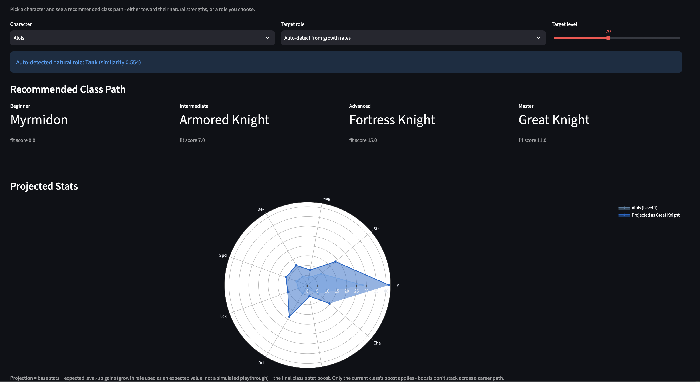
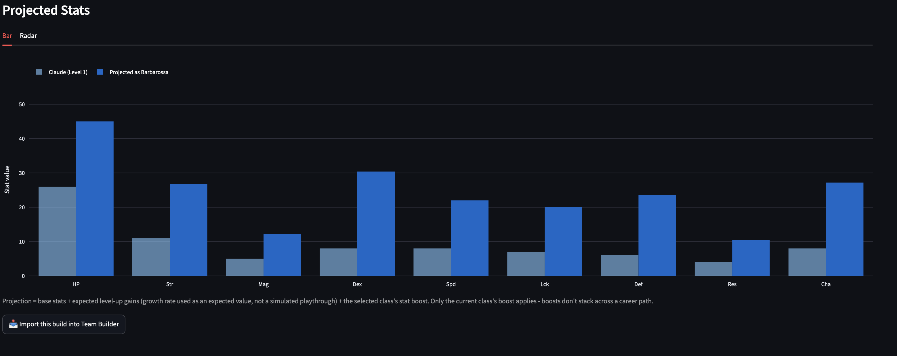

# Three Houses Class Optimizer

[](https://github.com/mam084/three-houses-optimizer/actions/workflows/tests.yml)


**[Try the live app →](https://three-houses-optimizer.streamlit.app)**

An interactive Streamlit app for *Fire Emblem: Three Houses* that answers two questions players argue about constantly:

1. **What class path should this character take?** The app detects what each character is naturally built for from their growth rates, then recommends a class at every tier (Beginner → Intermediate → Advanced → Master) and projects their stats at a target level.
2. **What team should I field on this route?** It builds a role-balanced squad from the characters actually available on the route you're playing.




## How it works

**Data.** Base stats, growth rates, and class stat boosts for 40 playable characters and 87 classes are scraped from [Serenes Forest](https://serenesforest.net/three-houses/) (`src/scrape_serenes.py`). Rules the site doesn't publish as clean tables (class eligibility, certification requirements, starting weapon talents, Hero's Relics, join levels, recruitment requirements) are hand-curated into small CSVs in `data/`.

**Role detection.** Each character's nine growth rates are z-scored against the whole roster, then compared by cosine similarity to five role archetypes (Physical Attacker, Magic Attacker, Tank, Support, Speed/Precision). Standardizing first matters: on raw percentages, mage-leaning characters like Hubert and Linhardt were misread as Support because their shared Resistance growth swamped their unusually high Magic. A small bounded nudge from a character's starting weapon talent and Hero's Relic breaks genuinely close calls.

**Class scoring.** At each tier, every class the character can legally take is scored for the target role:

- the dot product of the class's flat stat boosts with the role's stat weights
- plus a small weighted term for the class's own growth-rate modifiers
- plus small bonuses for matching the character's starting weapon talent or Hero's Relic
- minus a penalty (with a visible warning) when the class needs a weapon type the character has never trained anywhere earlier in the path

Eligibility rules are enforced throughout: gender-locked and character-locked classes, level gates for each tier, and Support restricted to classes that can actually cast healing magic. Character-unique classes (Byleth's Enlightened One, each lord's personal line) are preferred when they fit the role.

**Stat projection.** Stats are simulated tier by tier along the actual path: growth accrues using each tier's combined character and class growth rates, each class's own base stats act as a floor on certification, and only the final class's flat boost applies at the end, matching how the game works. Projections are expected values, not random rolls.

**Team building.** Characters available on the chosen route (including the Silver Snow split, optional cross-house recruits, and DLC characters) are assigned their natural roles, the game's force-deployed units are added, and a rotation fills whichever roles the team is still missing before repeating any. A weighted-random mode returns different reasonable teams on each click.

## Features

- **Character Optimizer** with auto-detected or manually chosen roles, a "why" explanation for every pick, a role-fit chart across all five archetypes, and mix-and-match overrides at any tier that recompute the projection live
- **Team Builder** with route-aware pools, must-include and exclude lists, a single roster-wide Dancer slot, and builds imported from the Character Optimizer
- **Class Explorer** for browsing any class's stat boosts and growth modifiers side by side
- **Build Comparer** for overlaying two complete builds (different characters, roles, or target levels) on one chart
- Shareable links: the Character Optimizer's selection is stored in URL query parameters

## Quick start

The app is live at **[three-houses-optimizer.streamlit.app](https://three-houses-optimizer.streamlit.app)**. To run it locally:


```bash
git clone https://github.com/mam084/three-houses-optimizer.git
cd three-houses-optimizer
pip install -r requirements.txt
streamlit run app.py
```

All game data ships in `data/`, so no scraping is needed to run the app. To refresh the scraped tables, run `python src/scrape_serenes.py`.

The recommender also runs from the command line:

```bash
python -m src.optimizer Lysithea
python -m src.optimizer Dedue --role "Magic Attacker" --level 30
python -m src.team_builder --house "Blue Lions" --size 6
python -m src.team_builder --house "Black Eagles (Silver Snow)" --size 8 --seed 42
```

Example output (abridged):

```
Lysithea
Auto-detected natural role: Magic Attacker (similarity 0.522)
Recommended path toward: Magic Attacker
       Beginner: Monk (fit score 1.0)
   Intermediate: Mage (fit score 2.88)
       Advanced: Warlock (fit score 4.8)
         Master: Gremory (fit score 7.25)
Expected stats at level 30 as Gremory:
  HP 33.0, Str 9.5, Mag 35.4, Dex 26.9, Spd 22.5, Lck 11.5, Def 12.5, Res 22.0, Cha 15.5
```

## Testing

```bash
python -m unittest discover -s tests -v
```

237 tests cover role detection, class scoring and eligibility, stat projection, team building, and a smoke test of every app tab. The smoke tests run against lightweight Streamlit/Plotly stand-ins in `tests/stubs/`, so the suite needs only pandas, NumPy, and Pillow. GitHub Actions runs it on Python 3.10–3.12 for every push, plus a separate job that imports the app against the real `requirements.txt`.

## Project structure

```
├── app.py                 # Streamlit entry point
├── app_state.py           # data loading and helpers shared across tabs
├── tabs/                  # one module per app tab
├── src/
│   ├── scrape_serenes.py  # Serenes Forest scraper
│   ├── optimizer/         # role detection, eligibility, scoring, path and stat projection
│   └── team_builder.py    # route pools and team assembly
├── data/                  # scraped and hand-curated CSVs
├── tests/                 # unittest suite and Streamlit/Plotly stubs
└── docs/                  # screenshots and design notes
```

## Limitations

- **Weapon experience isn't simulated.** Certification requirements are shown and factored into scoring, but the tool can't tell you whether a rank is actually reachable by a given level.
- **Each role is a single stat-weight vector.** It can't distinguish a bulky flier from a glass-cannon one under the same role. Letting players adjust role weights directly is the planned fix.
- **Late joiners' levels are approximate.** Join levels are exact for Byleth and the 24 house students; church staff and DLC characters use estimates.

[`docs/DESIGN_NOTES.md`](docs/DESIGN_NOTES.md) covers every modeling decision and simplification in detail.

## Roadmap

- [x] Deploy publicly: [three-houses-optimizer.streamlit.app](https://three-houses-optimizer.streamlit.app)
- [ ] Adjustable per-stat role weights ("advanced mode")
- [ ] Shareable Team Builder and Build Comparer links
- [ ] Sourced join levels for late-joining characters

## Data and credits

Game data from [Serenes Forest](https://serenesforest.net/three-houses/), a fan-maintained Fire Emblem reference. *Fire Emblem: Three Houses* is © Nintendo / Intelligent Systems / Koei Tecmo; this is an unofficial, non-commercial fan project. Character portraits in `assets/portraits/` are official game art belonging to those rights holders and are not covered by this repository's MIT license.
